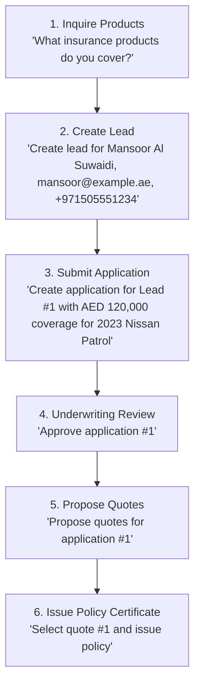

# 🛡️ Emirates Insurance Brokerage System

An enterprise-grade, Clean Architecture .NET 10 solution that automates the end-to-end UAE insurance brokerage lifecycle. The system integrates a **RESTful Core API**, an **Autonomous AI Orchestrator with a Chat Web Portal**, and a **Model Context Protocol (MCP) Server** connecting directly to SQL Server under UAE regulatory standards (CBUAE & DHA/DoH).

---

## 📑 Table of Contents
- [Architecture Overview](#-architecture-overview)
- [Key Features](#-key-features)
- [Prerequisites](#-prerequisites)
- [Getting Started & Installation](#-getting-started--installation)
  - [1. Clone the Repository](#1-clone-the-repository)
  - [2. Database Setup & Migrations](#2-database-setup--migrations)
  - [3. Configure AI Service / API Key](#3-configure-ai-service--api-key)
- [How to Run the Application](#-how-to-run-the-application)
  - [Method 1: One-Click Launch Script (Recommended)](#method-1-one-click-launch-script-recommended)
  - [Method 2: Visual Studio Code / Visual Studio (F5)](#method-2-visual-studio-code--visual-studio-f5)
  - [Method 3: Manual Terminal Startup](#method-3-manual-terminal-startup)
- [Service Endpoints](#-service-endpoints)
- [Insurance Lifecycle Workflow](#-insurance-lifecycle-workflow)
- [Project Structure](#-project-structure)
- [Troubleshooting & FAQs](#-troubleshooting--faqs)

---

## 🏛️ Architecture Overview

The solution follows **Clean Architecture / Hexagonal Architecture** principles:

```
                            ┌──────────────────────────────────────────┐
                            │    Web Browser (http://localhost:5051)   │
                            └────────────────────┬─────────────────────┘
                                                 │
                                                 ▼
┌────────────────────────────────────────────────────────────────────────────────────────┐
│  InsuranceBrokerage.AI  (AI Orchestrator & Web UI)                                     │
│  - Groq / Gemini / Ollama / Built-in Offline Reasoning Engine                          │
│  - Serves Modern Responsive Web Chat Interface                                         │
└──────────────┬───────────────────────────────────────────────────────────┬─────────────┘
               │                                                           │
               │ HTTP POST /chat                                           │ HTTP JSON-RPC (SSE)
               ▼                                                           ▼
┌───────────────────────────────────┐               ┌────────────────────────────────────┐
│   External LLM Provider           │               │   InsuranceBrokerage.McpServer     │
│   (Groq / Google / Ollama)        │               │   (Port 3001 - Model Context Proto)│
└───────────────────────────────────┘               └──────────────────┬─────────────────┘
                                                                       │
                                                                       │ Invokes Tools
                                                                       ▼
┌───────────────────────────────────┐               ┌────────────────────────────────────┐
│   InsuranceBrokerage.Api          │               │   InsuranceBrokerage.Application   │
│   (Port 5153 - REST API / Swagger)│──────────────►│   (Business Logic & DTOs)          │
└───────────────────────────────────┘               └──────────────────┬─────────────────┘
                                                                       │
                                                                       ▼
                                                    ┌────────────────────────────────────┐
                                                    │   InsuranceBrokerage.Infrastructure│
                                                    │   (EF Core 10, Repositories)       │
                                                    └──────────────────┬─────────────────┘
                                                                       │
                                                                       ▼
                                                    ┌────────────────────────────────────┐
                                                    │   Microsoft SQL Server             │
                                                    │   (InsuranceBrokerageDb)           │
                                                    └────────────────────────────────────┘
```

---

## ✨ Key Features

- **Lead Management:** Register customer inquiries for Motor, Health, and Property lines.
- **Application Submission:** Submit formal insurance applications in UAE Dirhams (AED) with vehicle/asset details.
- **Underwriting Risk Review:** Review and assess compliance under CBUAE regulations (`Approved`, `Rejected`, `MoreInformationRequired`).
- **Quote Comparison Engine:** Generate and rank competitive quotes across top UAE insurers:
  - 🏛️ **Sukoon Insurance** (Comprehensive cover, agency repair)
  - 🏛️ **ADNIC** (Abu Dhabi National Insurance Company)
  - 🏛️ **Orient Insurance** (Al-Futtaim Group)
- **Policy Issuance:** Automatically issue activated policy certificates with unique UAE brokerage reference IDs.
- **Model Context Protocol (MCP):** Stateless Streamable HTTP MCP server exposing backend services as tools to AI agents.
- **Dual AI Mode:** Supports live cloud LLMs (Groq, Google Gemini, OpenAI, Ollama) and includes a **100% offline rule-based reasoning engine** with zero external dependencies.

---

## 💻 Prerequisites

Ensure you have the following installed on your machine:

1. **[.NET 10 SDK](https://dotnet.microsoft.com/download/dotnet/10.0)** (Version `10.0.x` or later)
   - Verify by running: `dotnet --version`
2. **[Microsoft SQL Server](https://www.microsoft.com/sql-server/sql-server-downloads)** (SQL Server 2019/2022 Developer or Express edition) or **LocalDB**
   - Ensure the SQL Server service is active.
3. **[EF Core CLI Tools](https://learn.microsoft.com/ef/core/cli/dotnet)**:
   ```powershell
   dotnet tool install --global dotnet-ef
   ```
4. **[Git](https://git-scm.com/)**

---

## 🚀 Getting Started & Installation

### 1. Clone the Repository

```powershell
git clone https://github.com/Muthu-Meena-S/InsuranceBrokerage.git
cd InsuranceBrokerage
```

### 2. Database Setup & Migrations

The database connection string is pre-configured in `appsettings.json` to connect to your local SQL Server instance using Windows Authentication (`Trusted_Connection=True`):

```json
"Server=localhost;Database=InsuranceBrokerageDb;Trusted_Connection=True;TrustServerCertificate=True"
```

Apply the database migrations to create the database and tables:

```powershell
dotnet ef database update --project InsuranceBrokerage.Infrastructure --startup-project InsuranceBrokerage.Api
```

> [!NOTE]
> If your SQL Server instance uses SQL Authentication (username & password) or a named instance like `localhost\SQLEXPRESS`, update the connection string in both `InsuranceBrokerage.Api/appsettings.json` and `InsuranceBrokerage.McpServer/appsettings.json`.

---

### 3. Configure AI Service / API Key

The application can run in **two modes**:

#### Mode A: 100% Offline (Zero API Keys Needed)
If `ApiKey` is empty `""`, the AI Orchestrator runs on its built-in internal reasoning engine. It executes all MCP database tools locally with zero latency, zero rate limits, and no external calls.

#### Mode B: Cloud LLM (Groq / Gemini / OpenAI)
To enable live generative LLM reasoning, store your API key using **.NET User Secrets** (which prevents accidentally committing keys to Git):

```powershell
cd InsuranceBrokerage.AI
dotnet user-secrets init
dotnet user-secrets set "AiService:ApiKey" "your-api-key-here"
```

Default provider configuration in [`InsuranceBrokerage.AI/appsettings.json`](file:///InsuranceBrokerage.AI/appsettings.json):
```json
"AiService": {
  "Provider": "Groq",
  "ApiKey": "",
  "Model": "openai/gpt-oss-20b",
  "Endpoint": "https://api.groq.com/openai/v1"
}
```

*(You can also use Google Gemini by setting `Endpoint` to `https://generativelanguage.googleapis.com/v1beta/openai` and `Model` to `gemini-1.5-flash`)*.

---

## 🕹️ How to Run the Application

The system consists of **3 interconnected services**:
1. **MCP Server** (`InsuranceBrokerage.McpServer`) on Port `3001`
2. **REST API** (`InsuranceBrokerage.Api`) on Port `5153`
3. **AI Web Portal** (`InsuranceBrokerage.AI`) on Port `5051`

### Method 1: One-Click Launch Script (Recommended)

From the root repository folder, simply run:

```powershell
.\start-all.ps1
```
*Or double-click **`Start InsuranceBrokerage.bat`** in Windows Explorer.*

This script automatically:
- Stops any existing processes occupying ports 3001, 5153, or 5051.
- Spawns the MCP Server, REST API, and AI Portal in order with appropriate readiness delays.

---

### Method 2: Visual Studio Code / Visual Studio (F5)

- **VS Code:** Open the repository folder in VS Code and press **`F5`** (or select **Run & Debug** → **Run Insurance Brokerage**). The launcher automatically starts the companion services.
- **Visual Studio 2022/2025:** Set `InsuranceBrokerage.AI` as the Startup Project and press **`F5`**.

---

### Method 3: Manual Terminal Startup

If you prefer opening separate terminal tabs:

```powershell
# Terminal 1 — MCP Server (Must be started first)
cd InsuranceBrokerage.McpServer
dotnet run

# Terminal 2 — REST API
cd InsuranceBrokerage.Api
dotnet run

# Terminal 3 — AI Orchestrator Web Portal
cd InsuranceBrokerage.AI
dotnet run
```

---

## 🌐 Service Endpoints

| Service | Port / URL | Description |
| :--- | :--- | :--- |
| **AI Web Portal & Chat UI** | **[http://localhost:5051](http://localhost:5051)** | User interface for interacting with the brokerage AI agent |
| **REST API Swagger Docs** | **[http://localhost:5153/swagger](http://localhost:5153/swagger)** | Interactive OpenAPI/Swagger documentation for REST endpoints |
| **MCP Server Endpoint** | **[http://localhost:3001/mcp](http://localhost:3001/mcp)** | Model Context Protocol streamable JSON-RPC endpoint |

---

## 🔄 Insurance Lifecycle Workflow

Once the chat UI at **[http://localhost:5051](http://localhost:5051)** is open, you can test the entire UAE insurance lifecycle:



### Example Natural Language Commands

1. **Check Products:**
   > *"What insurance products do you offer?"*
2. **Register a Lead:**
   > *"Create lead for Mansoor Al Suwaidi, mansoor@example.ae, +971505551234"*
3. **View Leads:**
   > *"Show all active leads in the database"*
4. **Submit Application:**
   > *"Create application for Lead #1 with coverage AED 150,000 for 2024 Nissan Patrol"*
5. **Underwriting Review:**
   > *"Approve application #1"*
6. **Compare Quotes:**
   > *"Propose quotes for application #1"*
7. **Issue Policy:**
   > *"Select quote #1 and issue policy"*

---

## 📁 Project Structure

```text
InsuranceBrokerage/
├── InsuranceBrokerage.AI/               # Web Application & AI Orchestration layer
│   ├── Controllers / Models / Services/ # AI orchestrator & MCP client
│   └── wwwroot/                         # HTML5 / CSS3 / Vanilla JS Chat UI
│
├── InsuranceBrokerage.McpServer/        # Model Context Protocol (MCP) server
│   ├── Tools/InsuranceTools.cs         # Exposes tools (Leads, Apps, Quotes, Policies)
│   └── Program.cs                       # Configures stateless HTTP MCP server (/mcp)
│
├── InsuranceBrokerage.Api/              # Core ASP.NET Core Web API
│   ├── controll/                        # REST Controllers (Auth, Leads, Policies, etc.)
│   └── Program.cs                       # JWT Authentication, Swagger, DI
│
├── InsuranceBrokerage.Application/      # Use Cases, Interfaces, Services, DTOs
│   ├── Interfaces/                      # Repository and Service contracts
│   ├── Services/                        # LeadService, PolicyService, QuoteService
│   └── dto/                             # Data Transfer Objects
│
├── InsuranceBrokerage.Domain/           # Enterprise Entities & Business Rules
│   ├── Entities/                        # Lead, InsuranceApplication, Quote, Policy
│   └── Enums/                           # InsuranceType, ApplicationStatus, PolicyStatus
│
├── InsuranceBrokerage.Infrastructure/   # Data Access & External Implementations
│   ├── Data/BrokerageDbContext.cs       # Entity Framework Core DbContext
│   ├── Identity/ApplicationUser.cs      # ASP.NET Core Identity
│   ├── Migrations/                      # EF Core Code-First Migrations
│   └── Repositories/                    # Repository implementations
│
├── start-all.ps1                        # PowerShell script to launch all 3 projects
├── Start InsuranceBrokerage.bat         # Windows batch file for one-click launch
└── InsuranceBrokerage.slnx              # Modern .NET Solution definition
```

---

## ❓ Troubleshooting & FAQs

### 1. `Cannot open database "InsuranceBrokerageDb"`
- Run database migrations:
  ```powershell
  dotnet ef database update --project InsuranceBrokerage.Infrastructure --startup-project InsuranceBrokerage.Api
  ```
- Make sure SQL Server service is running in Windows Services (`services.msc`).

### 2. `Address already in use (Port 3001, 5153, or 5051)`
- Run `.\start-all.ps1`. The script automatically terminates stale background processes occupying those ports.

### 3. Rate Limit / Model Deprecation Errors
- If your Groq key hits free-tier rate limits, switch to **Google Gemini** or clear the API key to run on the built-in offline engine.

---

## 📜 License
This project is developed for educational and enterprise architectural demonstration purposes.

